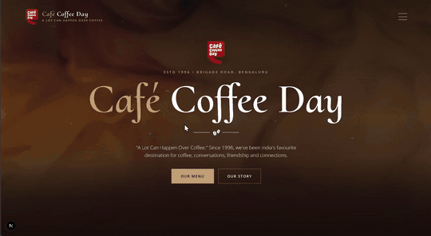

# ☕ Café Coffee Day — Digital Flagship

<p align="center">
  
</p>

<p align="center">
  <strong>Modern web storefront concept for Café Coffee Day.</strong><br/>
  Built with Next.js 15 App Router, React 19, TypeScript, Tailwind CSS, and GSAP ScrollTrigger.
</p>

<p align="center">
  <a href="https://vinothkumar-portfolio-mu.vercel.app/"><strong>Portfolio ↗</strong></a> •
  <a href="public/assets/previews/screen-recording.mp4"><strong>Watch HD Video</strong></a> •
  <a href="#quickstart"><strong>Quickstart</strong></a> •
  <a href="#architecture"><strong>Tech Stack</strong></a>
</p>

---

## ⚡ Key Highlights

- **GSAP ScrollTrigger:** Pinned horizontal scrolling journey across 3 heritage panels on Section 3.
- **Dedicated Menu Route (`/menu`):** Instant client-side search across 28 authentic products and 5 culinary varieties.
- **Responsive Navigation:** Touch-friendly mobile drawer with body scroll lock and quick customer care actions.
- **Performance Optimized:** Static route pre-rendering, modern asset compression, and zero cumulative layout shift.
- **Accessible & Compliant:** Themed 404 handler, active contact touchpoints, and dedicated legal privacy pages.

---

## 🛠️ Architecture

| Layer | Tool | Usage |
|---|---|---|
| **Framework** | Next.js 15 (App Router) | Static site generation, route pre-rendering, metadata API |
| **Library** | React 19 | Core UI components and state management |
| **Language** | TypeScript 5 | Strict end-to-end type safety |
| **Styling** | Tailwind CSS 3.4 | Dark luxury espresso design system & responsive layout |
| **Animation** | GSAP 3 + ScrollTrigger | Pinned horizontal timeline scrubbing |
| **Motion** | Framer Motion 11 | Parallax scrolling, drawer transitions & tab animations |

---

## 🚀 Quickstart

### Prerequisites
- Node.js 18.17+ or newer
- npm, pnpm, or yarn

### Installation

```bash
# 1. Clone repository
git clone https://github.com/Imvinothkumar/Cafe-Coffee-day-Website.git

# 2. Enter directory
cd Cafe-Coffee-day-Website

# 3. Install dependencies
npm install

# 4. Start local development server
npm run dev
```

Open [http://localhost:3000](http://localhost:3000) in your browser.

---

## 📁 Project Structure

```text
├── app/
│   ├── layout.tsx        # Root layout, fonts, and metadata
│   ├── page.tsx          # Main landing page (Hero, Explore, About, Menu, Hours)
│   ├── menu/page.tsx     # Dedicated menu page with live search
│   ├── research/page.tsx # Brand storytelling & estate history
│   ├── privacy/page.tsx  # Privacy policy
│   ├── terms/page.tsx    # Terms & conditions
│   ├── cookies/page.tsx  # Cookie compliance policy
│   └── not-found.tsx     # Themed 404 page
├── components/
│   ├── About.tsx         # GSAP ScrollTrigger horizontal section
│   ├── Explore/          # Signature beverage categories
│   ├── Menu/             # Product varieties and menu item cards
│   ├── Nav/              # Responsive mobile drawer
│   └── OpeningHours.tsx  # Store timings & highway lounge matrix
└── public/assets/        # Optimized media, branding, and preview assets
```

---

## 👤 Author

**VINOTHKUMAR P** — *Product Designer & Frontend Engineer*
- **Portfolio:** [vinothkumar-portfolio-mu.vercel.app](https://vinothkumar-portfolio-mu.vercel.app/)
- **Email:** [veeravinoth292@gmail.com](mailto:veeravinoth292@gmail.com)
- **Phone:** [+91 9361422036](tel:+919361422036)
- **GitHub:** [@Imvinothkumar](https://github.com/Imvinothkumar)
